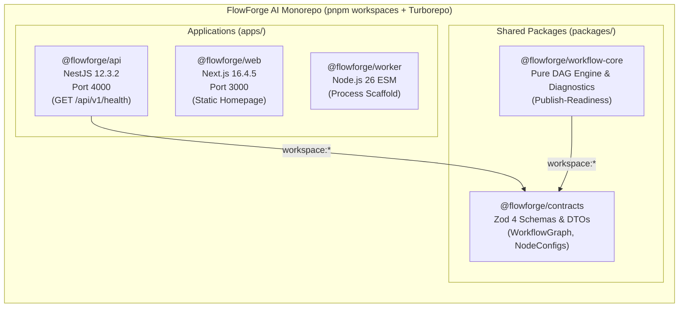
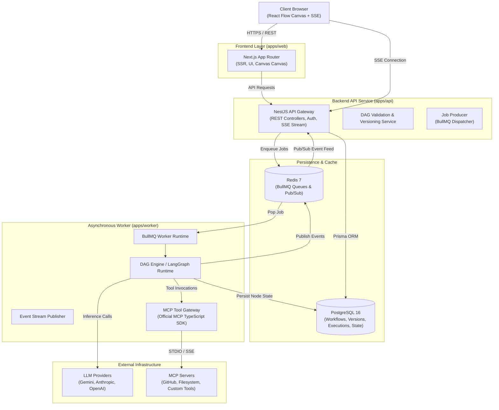
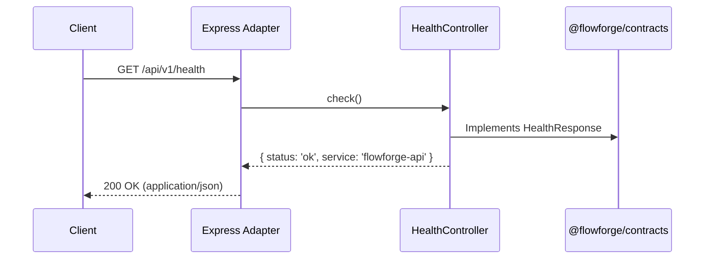
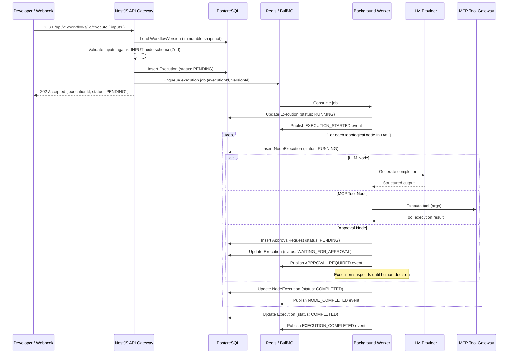
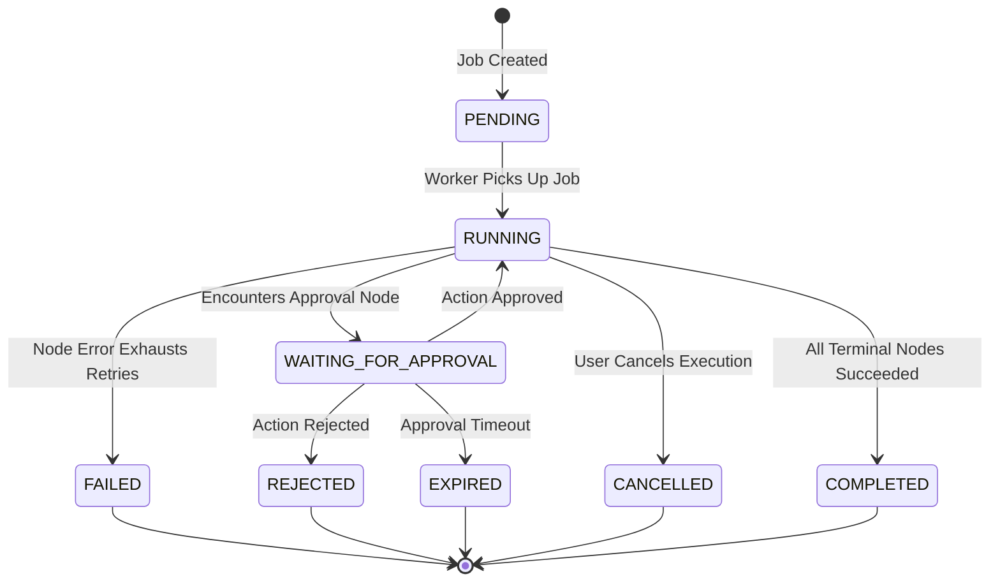
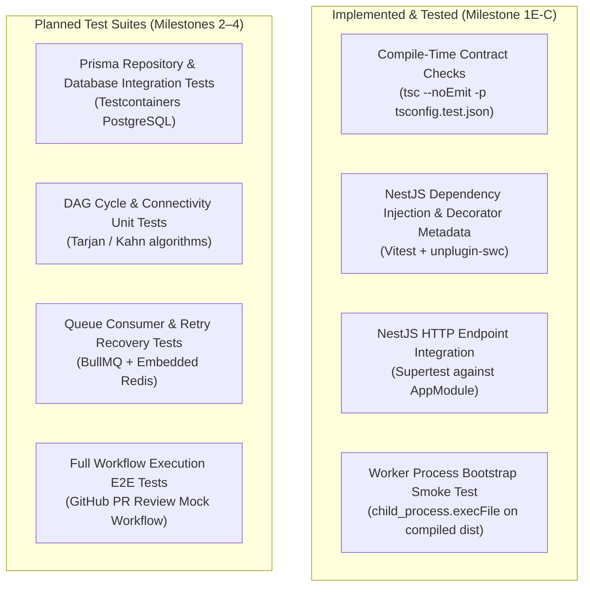
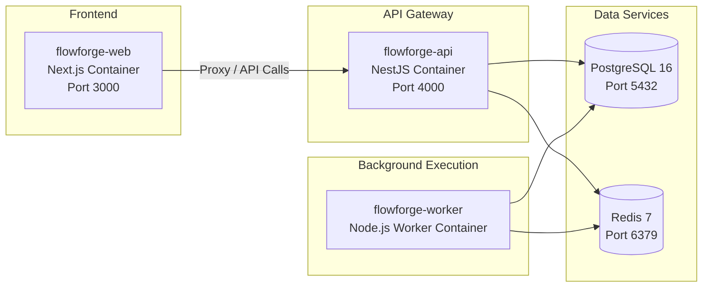

# FlowForge AI — System Architecture Document

**Document Version**: 1.0.0  
**Status**: APPROVED BASELINE  
**Milestone**: 1F-A  
**Target Architecture Implementation**: Phase 2 through Phase 4

---

## 1. Architecture Principles

The FlowForge AI architecture adheres to nine foundational engineering principles:

1. **Separation of Concerns**: User interaction (Next.js), API gateway and lifecycle management (NestJS), background processing (Node.js worker), and data contracts (`@flowforge/contracts`) reside in decoupled, single-responsibility domains.
2. **Cohesive, Modular Boundaries**: Applications and shared packages communicate exclusively across public, typed boundaries. Monorepo applications are prohibited from reaching into internal source files of sibling packages.
3. **Framework-Independent Domain Logic**: Workflow validation, DAG topological sorting, and execution state machines are modeled in pure TypeScript without coupling to NestJS, Next.js, or Express runtime classes.
4. **Strong Typing & Runtime Schema Validation**: Static TypeScript types are enforced across the workspace. All untrusted external inputs (API payloads, LLM responses, tool invocation results) are validated at runtime using Zod.
5. **Asynchronous, Durable Execution**: Long-running or multi-step operations must never block HTTP request threads. Executions are dispatched to distributed queues (BullMQ/Redis) and processed by independent worker runtimes.
6. **Immutable Published Workflows**: To ensure auditability and deterministic graph definitions, workflow definitions are snapshotted into immutable versions upon publishing. Executions execute against a frozen version snapshot, never an active draft. (Note: Immutable versions guarantee structural workflow definition reproducibility; they do NOT guarantee identical LLM generation results, unchanged model behavior, identical external API responses, or exactly-once external side effects).
7. **Testable Failure & Recovery Behavior**: Worker restarts, network timeouts, and external service errors are treated as routine occurrences. Workflows define explicit retry policies and durable checkpoints.
8. **Secure External Side-Effect Execution**: External tool execution (via Model Context Protocol) is gated by workspace authorization and human-in-the-loop approval before executing mutating actions.
9. **No Fake Guarantees**: External operations cannot guarantee exactly-once execution without third-party idempotency support. The system explicitly designs for at-least-once execution and external reconciliation.

---

## 2. Current Implemented Architecture (Phase 2B Baseline)

The repository provides the verified Phase 1 Engineering Foundation, Phase 2A Shared Contracts & Node Configurations, and Phase 2B Workflow Graph Core & DAG Analysis. No business features, database connections, message queues, publishing endpoints, or execution engines have been connected yet.



### 2.1 Implemented & Verified Components

- **`apps/web`**: Next.js 16.4.5 App Router application with React 19.3.1. Serves a static homepage foundation on port 3000. Verified via Next.js Turbopack production builds, TypeScript checking, and ESLint.
- **`apps/api`**: NestJS 12.3.2 application operating under NodeNext ESM on port 4000. Configured with a global route prefix (`api/v1`). Exposes `GET /api/v1/health`. Verified via Vitest HTTP integration tests (Supertest) and dependency injection metadata tests.
- **`apps/worker`**: Standalone Node.js 26 background process scaffold with NodeNext ESM. Verified via child-process smoke tests asserting stdout diagnostic output, empty stderr, and zero exit code.
- **`packages/contracts`**: Framework-independent shared contract package exporting:
  - System health probe contracts (`HealthResponse`).
  - Workflow graph structural contracts (`WorkflowNodeTypeSchema`, `WorkflowNodeSchema`, `WorkflowEdgeSchema`, `WorkflowGraphSchema`, `WorkflowIdentifierSchema`).
  - Discriminated value bindings (`LiteralBindingSchema`, `InputValueReferenceSchema`, `NodeOutputValueReferenceSchema`, `ValueBindingSchema`).
  - Seven typed node-specific configuration schemas (`INPUT`, `OUTPUT`, `TRANSFORM`, `CONDITION`, `LLM`, `MCP_TOOL`, `APPROVAL`).
  - Discriminated configured node union (`ConfiguredWorkflowNodeSchema`, `ConfiguredWorkflowNode`).
  - Workflow-level node configuration validation and diagnostics (`validateNodeConfig`, `validateWorkflowNodeConfigs`, `formatValidationPath`).
  - Verified via 440 Vitest runtime schema tests and compile-time type constraint testing (`@ts-expect-error`).
- **`packages/workflow-core`**: Standalone, framework-independent pure DAG analysis and static validation engine exporting:
  - Graph structural integrity and deterministic topological sorting (`analyzeWorkflowGraph`).
  - CONDITION branch rules and static forward/reverse reachability (`validateWorkflowGraphSemantics`).
  - Strict entry/terminal boundary topology (`validateWorkflowEntryExitTopology`).
  - Static node-output reference lineage and reverse DAG ancestry (`validateWorkflowNodeOutputReferences`).
  - Workflow-wide trigger input reference scope and ambiguity validation (`validateWorkflowInputReferences`).
  - Branch-conditioned node-output path coverage and advisory dominance analysis (`analyzeWorkflowNodeOutputPathCoverage`).
  - Unified static publish-readiness assessment orchestrating the 5-stage validation pipeline (`validateWorkflowPublishReadiness`).
  - Verified via 389 Vitest runtime unit and integration tests across 7 test files.
- **Tooling & Orchestration**: pnpm 12.16.1 workspaces, Turborepo 2.11.10 task pipeline, TypeScript 6.0.3 strict base, ESLint 10.14.0 flat config, and Prettier 3.9.10.

### 2.2 Current Limitations (What Is NOT Yet Implemented)

- **Database**: No PostgreSQL connection, Prisma schema, or persistence layer exists (`packages/database` will be implemented in Phase 2C).
- **Queue / Cache**: No Redis connection or BullMQ queue integration exists (deferred to Phase 3).
- **Authentication & Workspace Scoping**: No user accounts, sessions, JWT verification, or workspace membership checks exist (Phase 2C).
- **Workflow Publishing Endpoints & Version Persistence**: No HTTP endpoints for saving/publishing workflows (`POST /api/v1/workflows/:id/publish`), database transactions, or immutable version snapshotting exist. `validateWorkflowPublishReadiness` provides pure design-time static assessment only.
- **Workflow Execution**: No DAG execution runtime, worker task dispatch, LLM provider calls, MCP connections, or state machine exists.
- **Inter-service Communication**: `apps/web` does not yet call `apps/api`.

---

## 3. Target Architecture (Phase 2–4 Roadmap)

The planned target architecture introduces persistent relational storage, distributed queueing, an execution engine, real-time event streaming, and Model Context Protocol (MCP) integrations (Note: PostgreSQL and Redis are the approved architectural choices; version numbers such as PostgreSQL 16 and Redis 7 represent candidate baseline examples to be finalized during Phase 2 infrastructure setup):



---

## 4. Monorepo Organization & Boundaries

### 4.1 Monorepo Directory Layout

```text
flowforge-ai/
├── apps/
│   ├── web/                # Frontend application (@flowforge/web)
│   ├── api/                # Backend API service (@flowforge/api)
│   └── worker/             # Background execution worker (@flowforge/worker)
├── packages/
│   ├── contracts/          # Public DTOs and API interfaces (@flowforge/contracts)
│   ├── workflow-core/      # PLANNED: Pure DAG validation and execution logic
│   └── database/           # PLANNED: Prisma client, migrations, and repositories
├── tests/                  # Multi-package integration, E2E, and load suites
├── docs/                   # Architecture Decision Records (ADRs) and specs
├── turbo.json              # Task dependency graph and caching rules
└── pnpm-workspace.yaml     # Monorepo workspace package definitions
```

### 4.2 Monorepo Boundary Rules

1. **Public Contracts Boundary**: All shared interfaces, DTOs, and schema types must reside in `packages/contracts`. Consumers import types exclusively from `@flowforge/contracts`.
2. **No Peer Application Imports**: Code in `apps/api` must never import from `apps/web` or `apps/worker` (and vice-versa).
3. **Workspace Linking**: Workspace dependencies must use `"workspace:*"`.
4. **Upstream Declaration Compilation**: Turborepo enforces `"typecheck": { "dependsOn": ["^build"] }` and `"test": { "dependsOn": ["^build"] }`, ensuring upstream declarations in `packages/` build before downstream consumers typecheck or test.
5. **Future Domain Packages**: `packages/workflow-core` (pure graph logic) and `packages/database` (Prisma client) will be created when implementation requires them. They must remain framework-agnostic.

---

## 5. Request & Execution Lifecycles

### 5.1 Implemented Request Lifecycle: Liveness Probe



### 5.2 Target Execution Request Lifecycle (Planned)



---

## 6. Workflow & Execution State Machine

### 6.1 Workflow Lifecycle (Design-Time)

A workflow progresses through three distinct states:

1. **`DRAFT`**: Mutable canvas graph saved in PostgreSQL. Editable by workspace members.
2. **`VALIDATING`**: Graph is processed by cycle detection and schema check algorithms.
3. **`PUBLISHED`**: Graph is frozen into an immutable `WorkflowVersion` row with an incremented version number (`v1`, `v2`). Once published, the version cannot be mutated.

### 6.2 Execution Lifecycle (Runtime)

An execution follows a deterministic finite state machine:



### 6.3 Conditional Execution & DAG Traversal Semantics

- **Topological Order vs. Activation**: Topological sorting establishes a valid dependency evaluation sequence, but does not dictate unconditional execution of every node.
- **Branch Selection**: A `CONDITION` node evaluates upstream data and activates specific outbound edges.
- **Skipped Nodes**: Nodes on unselected branches transition to `SKIPPED`. Downstream nodes that depend strictly on skipped outputs are recursively marked `SKIPPED`.
- **Join Semantics (Open Decision)**: When multiple branches converge into a single downstream node, the execution engine must determine whether the join behaves as an `AND` join (all inbound edges must succeed) or an `OR`/`ANY` join (executes as soon as any active path succeeds). Detailed join semantics remain an open technical design decision.

---

## 7. Conceptual Data Architecture

The target relational schema (to be implemented via Prisma in Milestone 2) comprises 13 core entities:

| Entity            | Purpose                                               | Key Relationships                                       |
| ----------------- | ----------------------------------------------------- | ------------------------------------------------------- |
| `User`            | User account and credentials.                         | Has many `WorkspaceMember`.                             |
| `Workspace`       | Tenant boundary for workflows, credentials, and logs. | Has many `Workflow`, `Integration`, `Member`.           |
| `WorkspaceMember` | Associative role (`OWNER`, `EDITOR`, `VIEWER`).       | Belongs to `User` and `Workspace`.                      |
| `Workflow`        | Top-level workflow definition container.              | Belongs to `Workspace`, has many `WorkflowVersion`.     |
| `WorkflowVersion` | Immutable snapshot of a published DAG.                | Belongs to `Workflow`, has many `Execution`.            |
| `Execution`       | Run instance of an immutable `WorkflowVersion`.       | Belongs to `WorkflowVersion`, has many `NodeExecution`. |
| `NodeExecution`   | State and output of an individual node run.           | Belongs to `Execution`.                                 |
| `ExecutionEvent`  | Granular audit and streaming event.                   | Belongs to `Execution`.                                 |
| `ApprovalRequest` | Paused execution approval gate.                       | Belongs to `Execution` and `NodeExecution`.             |
| `Integration`     | Connected external service (e.g., GitHub, Slack).     | Belongs to `Workspace`.                                 |
| `Credential`      | Encrypted authentication secret (AES-256-GCM).        | Belongs to `Integration` or `Workspace`.                |
| `ToolInvocation`  | Log of external MCP tool calls with input/output.     | Belongs to `NodeExecution`.                             |
| `OutboxEvent`     | Transactional outbox for reliable event dispatch.     | Managed by API and Worker transactions.                 |

---

## 8. Reliability & Failure Recovery Model

### 8.1 At-Least-Once Delivery & Idempotency

- **Queue Semantics**: BullMQ provides at-least-once message delivery. A worker failure or crash triggers job visibility timeout and re-delivery.
- **Node Execution Idempotency**: Each node execution is assigned a deterministic idempotency key (`executionId:nodeId:attempt`). When a worker picks up a re-delivered job, it queries `NodeExecution` records in PostgreSQL to skip already completed upstream nodes.
- **External Side-Effect Reality**: External tool executions (e.g., posting a GitHub PR comment) cannot be guaranteed exactly-once without remote idempotency keys. If an external API lacks deduplication support, retrying a timed-out call may result in duplicate actions. The system mitigates this by capturing external response IDs and supporting human approval gates for critical mutations.

### 8.2 Transactional Outbox Pattern & Event Streaming

The architecture strictly distinguishes durable persistence from real-time event streaming:

1. **Durable Database Transactions**: When the API or worker changes execution or node state, it writes the state change (`Execution`, `NodeExecution`) and an `OutboxEvent` record within a single atomic PostgreSQL transaction. Writing to PostgreSQL and publishing to Redis do NOT occur in a single distributed transaction.
2. **Ephemeral Event Transport**: A lightweight background publisher relays committed `OutboxEvent` records to Redis Pub/Sub. Redis Pub/Sub acts strictly as an ephemeral, fire-and-forget transport for live UI broadcast; it is NOT a durable queue (durable queuing is handled separately by BullMQ backed by Redis data structures).
3. **Frontend Delivery via SSE**: The NestJS API subscribes to Redis Pub/Sub channels and streams events to clients over Server-Sent Events (SSE).
4. **Replay & Catch-Up**: If an SSE connection drops or Redis Pub/Sub messages are lost during network partitions, client reconnect logic requests historical events directly from PostgreSQL (`GET /api/v1/executions/:id/events?since=<timestamp>`), ensuring reliable event recovery without relying on pub/sub persistence.

### 8.3 Retry & Error Classification

- **Transient Failures** (HTTP 429 rate limits, HTTP 503 service unavailable, socket timeouts): Retried automatically using exponential backoff with jitter.
- **Terminal Failures** (Zod schema validation mismatch, HTTP 401/403 permission denied, malformed prompt): Mark the node as `FAILED` immediately without retry.

---

## 9. Security Architecture

### 9.1 Authentication & Workspace Scoping

- User sessions are authenticated using secure HTTP-only session cookies / JWTs.
- Every API endpoint verifies that the authenticated user possesses valid `WorkspaceMember` authorization before reading or modifying workflows or executions.

### 9.2 Secret Storage & Credential Isolation

- External API keys (OpenAI, Anthropic, GitHub Personal Access Tokens) are encrypted at rest using AES-256-GCM with environment-provided master keys.
- Worker runtimes decrypt secrets in-memory only for the duration of the tool or LLM invocation. Secrets are never exposed in execution logs, event streams, or database output columns.

### 9.3 Model Context Protocol (MCP) Security Boundaries

- MCP servers run in isolated subprocesses using the official MCP TypeScript SDK v2 over `stdio` or authenticated HTTP/SSE transports.
- Tool schemas are validated via Zod before invocation.
- Write operations (e.g., modifying git repositories, creating pull requests, issuing review comments) are classified as `PROTECTED_TOOL` and require explicit human-in-the-loop authorization via an `APPROVAL` node.

---

## 10. Testing Architecture

The monorepo enforces a multi-tiered testing strategy:



---

## 11. Containerized Deployment Architecture (Target)

In production and local integration environments, the system deploys as isolated Docker containers coordinated via Docker Compose or container orchestrators:



---

## 12. Technical Risks & Open Architectural Decisions

| Risk / Decision Area                   | Impact                                                                         | Mitigation Strategy                                                                         | Status                     |
| -------------------------------------- | ------------------------------------------------------------------------------ | ------------------------------------------------------------------------------------------- | -------------------------- |
| **External Side-Effect Duplication**   | Retried tool calls may duplicate external actions (e.g. multiple PR comments). | Enforce human approval on mutating actions; store external response IDs for reconciliation. | **DOCUMENTED REQUIREMENT** |
| **Worker Crash during LLM Invocation** | Long-running LLM calls ($> 30\text{s}$) lost if worker restarts.               | BullMQ job lock renewal (`heartbeat`); persist intermediate node outputs immediately.       | **PLANNED**                |
| **LLM Output Schema Drift**            | LLM responses occasionally deviate from requested JSON schemas.                | Strict Zod validation; retry node with correction prompt on parsing error.                  | **PLANNED**                |
| **MCP Subprocess Security**            | Malicious or buggy MCP servers could exhaust host resources.                   | Execute MCP servers under restricted OS accounts with bounded timeouts.                     | **PLANNED**                |
| **Redis Memory Pressure**              | High execution event volume could exhaust Redis memory.                        | Configure Redis `maxmemory-policy volatile-lru`; stream events directly to PostgreSQL.      | **PLANNED**                |
| **Production Hosting Provider**        | Hosting constraints (AWS ECS vs. Railway vs. DigitalOcean).                    | Containerized multi-stage Docker builds ensure portability across any Docker host.          | **OPEN PROPOSAL**          |
| **Database & Queue Release Versions**  | Specific image and engine tags for PostgreSQL and Redis.                       | PostgreSQL 16.x and Redis 7.x are candidate baselines; exact tags finalized in Phase 2.     | **OPEN PROPOSAL**          |
| **Conditional Branch Join Semantics**  | Behavior of converging nodes following skipped conditional paths.              | Define whether join nodes require all incoming paths or any active path; evaluate in core.  | **OPEN DECISION**          |
| **Database & Queue Release Versions**  | Specific image and engine tags for PostgreSQL and Redis.                       | PostgreSQL 16.x and Redis 7.x are candidate baselines; exact tags finalized in Phase 2.     | **OPEN PROPOSAL**          |
| **Conditional Branch Join Semantics**  | Behavior of converging nodes following skipped conditional paths.              | Define whether join nodes require all incoming paths or any active path; evaluate in core.  | **OPEN DECISION**          |

---

_End of System Architecture Document._
