# FlowForge AI — Implementation & Development Plan

**Document Version**: 1.0.0  
**Status**: APPROVED BASELINE  
**Milestone**: 1F-B2  
**Target Horizon**: Phase 1 through Phase 4

---

## 1. Project Goal

FlowForge AI is a visual, durable AI workflow orchestration platform designed for technical developers and engineering teams. It provides deterministic Directed Acyclic Graph (DAG) validation, asynchronous execution runtimes, Model Context Protocol (MCP) integrations, human-in-the-loop approval gates, and immutable workflow versioning.

The platform's flagship demonstration use case is **GitHub Pull Request Review Automation**:

1. Ingest pull request metadata and changed file diffs.
2. Perform multi-aspect LLM analysis (security, logic, code quality).
3. Evaluate conditional branching based on findings.
4. Pause for human authorization prior to mutating external repositories.
5. Publish review summaries to GitHub via an MCP tool.
6. Persist execution history with node-level observability.

---

## 2. Working Principles

All development on FlowForge AI strictly follows these nine engineering principles:

1. **Small, Independently Reviewable Chunks**: Every milestone is scoped to a single cohesive deliverable with explicit verification criteria.
2. **Inspect Before Modifying**: Never assume runtime versions, dependency manifests, or existing code structure without inspecting disk state first.
3. **Modular Code Without Speculative Abstractions**: Avoid premature generalizations, generic utility wrappers, or unused mock frameworks.
4. **Verify Before Advancing**: A milestone is incomplete until verified through positive tests, negative error-propagation tests, clean-build checks, and regression suites.
5. **Preserve Architectural Boundaries**: Applications (`apps/`) must never import private source files from sibling applications. Shared logic must reside in public workspace packages (`packages/`).
6. **No Fake Claims**: Never report unimplemented functionality, unconfigured queues, or unverified remote CI runs as complete.
7. **Developer Controls Commits & Infrastructure**: Antigravity agents execute code changes and local verification; the human developer creates Git commits, manages branches, and provisions external credentials.
8. **Architectural Changes Require Explicit Review**: Modifying the approved tech stack or introducing new shared packages requires formal review and ADR documentation.
9. **Defensible Reliability Over False Promises**: At-least-once execution and idempotency checkpoints are engineered realistically; external side effects cannot be guaranteed exactly-once without third-party idempotency support.

---

## 3. Phase 1 — Engineering Foundation (Current Phase)

Phase 1 establishes the verified monorepo foundation, applications, shared contracts, testing infrastructure, and architectural governance.

### 3.1 Phase 1 Milestone Table

| Milestone | Subject                           | Deliverables                                                                                                                   | Verification State                                                     | Status                             |
| --------- | --------------------------------- | ------------------------------------------------------------------------------------------------------------------------------ | ---------------------------------------------------------------------- | ---------------------------------- |
| **1A**    | Repository & Monorepo Foundation  | pnpm 12 workspaces, Turborepo, `.nvmrc` (Node 26), `.editorconfig`, `.gitignore`                                               | Local verification of `pnpm install` and Turbo task pipeline           | **COMPLETED**                      |
| **1B**    | TypeScript & Code-Quality Tooling | `tsconfig.base.json`, ESLint 10 flat config (`eslint.config.mjs`), Prettier (`.prettierrc.json`)                               | `format:check`, `lint:root`, root quality scripts                      | **COMPLETED**                      |
| **1C-A**  | Next.js Frontend Scaffold         | `apps/web` (Next.js 16.4.5, React 19.3.1, App Router, static home)                                                             | Turbopack production build, TypeScript check, ESLint                   | **COMPLETED**                      |
| **1C-B**  | NestJS Backend API Scaffold       | `apps/api` (NestJS 12.3.2, NodeNext ESM, port 4000, `GET /api/v1/health`)                                                      | Production build, HTTP 200 health probe, HTTP 404 routes               | **COMPLETED**                      |
| **1C-C**  | Standalone Worker Scaffold        | `apps/worker` (Node.js 26 standalone ESM runtime process scaffold)                                                             | TypeScript build, production start smoke check                         | **COMPLETED**                      |
| **1D**    | Shared Contracts Package          | `packages/contracts` (`@flowforge/contracts@0.1.0`, `HealthResponse`)                                                          | Linked via `workspace:*`, Turbo upstream build dependency (`^build`)   | **COMPLETED**                      |
| **1E-A**  | NestJS API Automated Tests        | Vitest 5, `unplugin-swc` decorator metadata, Supertest e2e suite                                                               | DI parameter resolution test, HTTP e2e routes, negative test           | **COMPLETED**                      |
| **1E-B1** | Worker Process Testing            | Vitest 5, `child_process.execFile` process smoke test on `dist/main.js`                                                        | Process startup assertion, stdout check, timeout guard, negative test  | **COMPLETED**                      |
| **1E-B2** | Shared Contract Type Tests        | Compile-time type assertions via `tsc --noEmit -p tsconfig.test.json`                                                          | 5 positive & negative constraints verified via `@ts-expect-error`      | **COMPLETED**                      |
| **1E-C**  | Testing Infrastructure Audit      | Full audit of lockfile, boundaries, clean-build reproducibility                                                                | Frozen lockfile install, cold build/test runs, 0 test files in `dist/` | **COMPLETED**                      |
| **1F-A**  | PRD & Architecture Documentation  | Authoritative [`PRD.md`](./PRD.md) and [`ARCHITECTURE.md`](./ARCHITECTURE.md)                                                  | Verified against code manifests; 0 regressions                         | **COMPLETED**                      |
| **1F-B1** | Technical Decisions & ADRs        | [`TECHNICAL_DECISIONS.md`](./TECHNICAL_DECISIONS.md), 4 foundational ADRs in `docs/adr/`                                       | All relative links verified; architectural consistency adjusted        | **COMPLETED**                      |
| **1F-B2** | Development Plan & Progress Logs  | [`DEVELOPMENT_PLAN.md`](./DEVELOPMENT_PLAN.md), [`DEVELOPMENT_LOG.md`](./DEVELOPMENT_LOG.md), [`CHANGELOG.md`](./CHANGELOG.md) | Verified against repository history and governance hierarchy           | **COMPLETED**                      |
| **1G**    | GitHub Actions CI Pipeline        | [`.github/workflows/ci.yml`](./.github/workflows/ci.yml) (quality-and-tests pipeline under Node 26 & pnpm 12)                  | Local verification passed; remote CI run pending first push            | **COMPLETED** (Local Verification) |
| **1H**    | Phase 1 Verification & Commit     | Full regression check, clean git status review, manual developer commit                                                        | Final Phase 1 sign-off; single clean commit created manually           | **NOT STARTED**                    |

### 3.2 Phase 1 Exit Criteria

Before Phase 1 is marked finished and Phase 2 begins, the following gates must be met:

1. `pnpm install --frozen-lockfile` runs with zero warnings or lockfile diffs.
2. `pnpm run format:check`, `pnpm run lint:root`, `pnpm run lint`, `pnpm run typecheck`, and `pnpm run test` all pass with exit code `0`.
3. Cold clean-builds (deleting `dist/` across all projects) compile and test without errors.
4. Production build outputs (`dist/`, `.next/`) contain zero test specifications.
5. GitHub Actions workflow definition is in place and syntax-checked locally.
6. Documentation links (`PRD.md`, `ARCHITECTURE.md`, `TECHNICAL_DECISIONS.md`, ADRs, plan, log, changelog) resolve cleanly.
7. Human developer reviews all staged and unstaged work, verifies integrity, and manually executes the Phase 1 Git commit.

_Note on Remote CI_: Local Phase 1 completion verifies that the workflow file is syntactically valid and matches local scripts. Actual GitHub Actions remote execution will be confirmed upon the first repository push.

---

## 4. Future Implementation Roadmap (Phases 2–4)

```mermaid
flowchart TD
    subgraph Phase1["Phase 1: Foundation (Current)"]
        P1_Mono["Monorepo & Apps Scaffold"] --> P1_Test["Automated Testing Suite"]
        P1_Test --> P1_Docs["PRD, Architecture, ADRs, Plans"]
        P1_Docs --> P1_CI["GitHub Actions CI (1G)"]
        P1_CI --> P1_Commit["Phase 1 Manual Commit (1H)"]
    end

    subgraph Phase2["Phase 2: Domain & Persistence"]
        P2_Schemas["Runtime Schemas (Zod)"] --> P2_GraphCore["Graph Core & DAG Validation"]
        P2_GraphCore --> P2_DB["PostgreSQL & Prisma Setup"]
        P2_DB --> P2_Models["Domain Models & Migrations"]
        P2_Models --> P2_Auth["Auth & Workspace Authorization"]
        P2_Auth --> P2_CRUD["Workflow Draft CRUD"]
        P2_CRUD --> P2_Version["Immutable Versioning Engine"]
        P2_Version --> P2_DBTests["Persistence Integration Tests"]
    end

    subgraph Phase3["Phase 3: Durable Execution & AI"]
        P3_Queue["Redis & BullMQ Queue Setup"] --> P3_Worker["Worker Queue Consumer"]
        P3_Worker --> P3_FSM["Execution State Machine"]
        P3_FSM --> P3_Outbox["Transactional Outbox & SSE"]
        P3_Outbox --> P3_Idempotency["Checkpoints & Idempotency"]
        P3_Idempotency --> P3_LLM["LLM Integration (Zod Outputs)"]
        P3_LLM --> P3_MCP["MCP Tool Gateway (GitHub Tool)"]
        P3_MCP --> P3_Approval["Human Approval Gate (Pause/Resume)"]
        P3_Approval --> P3_Failover["Worker Crash Recovery Tests"]
    end

    subgraph Phase4["Phase 4: Visual Canvas, Demo & Hardening"]
        P4_Canvas["React Flow Visual Canvas"] --> P4_Nodes["Node Configuration Panels"]
        P4_Nodes --> P4_LiveExec["Live Execution Monitoring (SSE)"]
        P4_LiveExec --> P4_ApprovalUI["In-App Approval Decision UI"]
        P4_ApprovalUI --> P4_Demo["Flagship GitHub PR Review Demo"]
        P4_Demo --> P4_Docker["Docker Multi-Stage Containerization"]
        P4_Docker --> P4_Hardening["Security Audit & Final Polish"]
    end

    P1_Commit --> P2_Schemas
    P2_DBTests --> P3_Queue
    P3_Failover --> P4_Canvas
```



---

## 5. Phase 2 — Domain & Persistence Foundation

**Objective**: Establish runtime schema validation, pure workflow graph algorithms (cycle detection, topological sort), relational database persistence with PostgreSQL and Prisma, workspace-scoped authorization, and immutable workflow publishing.

### Workstream Breakdown:

1. **Runtime Validation Schemas (`packages/contracts`)**:
   - **Milestone 2A-A (Completed)**: Basic workflow graph contracts and Zod 4 runtime schemas (`WorkflowNodeTypeSchema`, `WorkflowNodeSchema`, `WorkflowEdgeSchema`, `WorkflowGraphSchema`, `WorkflowIdentifierSchema`) with Vitest runtime testing. Strict structural validation enforced with zero mutation of valid identifiers.
   - **Milestone 2A-B (Completed)**: Typed, node-specific configuration schemas for approved V1 node kinds:
     - **Milestone 2A-B1a (Completed)**: Standalone `InputNodeConfigSchema`, `InputFieldDefinitionSchema`, and `InputFieldTypeSchema` in `@flowforge/contracts` with strict default-value type compatibility, zero-field INPUT support, and draft compatibility tests.
     - **Milestone 2A-B1b (Completed)**: Reusable value bindings (`LiteralBindingSchema`, `InputValueReferenceSchema`, `NodeOutputValueReferenceSchema`, `ValueBindingSchema`) and `OutputNodeConfigSchema` with bounded property-path segment arrays, draft backward compatibility, and 49 runtime tests.
     - **Milestone 2A-B1c (Completed)**: Declarative `TransformNodeConfigSchema` with 4 approved V1 operations (`json_pick`, `json_set`, `template_string`, `math_op`), static template segment arrays, finite arithmetic validation, draft backward compatibility, and 43 runtime tests.
     - **Milestone 2A-B2a (Completed)**: `ConditionNodeConfigSchema` (binary & unary operators), `ConditionOutcomeSchema` ('TRUE' | 'FALSE'), and explicit edge condition outcome metadata on `WorkflowEdgeSchema` (strictly rejecting explicit `undefined`), with 45 runtime tests.
     - **Milestone 2A-B2b (Completed)**: Provider-agnostic `LlmNodeConfigSchema`, string-only `LlmPromptLiteralBindingSchema`, `LlmPromptBindingSchema`, optional generation parameters (`systemInstruction`, `temperature`, `maxTokens`, `responseFormat`), and strict rejection of credential fields, with 50 runtime tests.
     - **Milestone 2A-B2c (Completed)**: Framework-independent `McpToolNodeConfigSchema` with workspace-scoped `integrationRef`, `toolName`, `arguments` (`Record<string, ValueBinding>`, max 50 entries), optional `timeoutMs` (500–300,000 ms), and strict security boundaries, with 51 runtime tests.
     - **Milestone 2A-B2d (Completed)**: Human `ApprovalNodeConfigSchema` with explicit role policy (`ApproverRoleSchema`: `'OWNER' | 'ADMIN' | 'MEMBER'`), bounded timeout (1–10,080 minutes), explicit timeout actions (`'REJECT' | 'EXPIRE'`), and strict rejection of self-authorization bypasses, with 45 runtime tests.
     - **Milestone 2A-B3a (Completed)**: Typed workflow node composition and Zod 4 discriminated union (`ConfiguredWorkflowNodeSchema`, `ConfiguredWorkflowNode`) uniting all seven fully configured node variants, strict type narrowing, JSON serializability consistency across schemas (rejecting explicit `undefined`), preservation of draft compatibility (`WorkflowNodeSchema` still accepts `{ config: {} }`), and 43 runtime Vitest tests.
     - **Milestone 2A-B3b (Completed)**: Workflow-level node configuration validation and editor-ready diagnostics (`validateNodeConfig`, `validateWorkflowNodeConfigs`, `formatValidationPath`) collecting all configuration issues across draft graphs without short-circuiting, preserving exact node IDs, indices, and structured error paths, with 47 runtime tests. (Phase 2A Complete).
   - _Deliverables_: Exported schemas, validator functions, and inferred types in `@flowforge/contracts`.
2. **Workflow Graph Core (`packages/workflow-core`)**:
   - Create a framework-independent domain package.
   - Implement cycle detection using Kahn's algorithm, connectivity checks, and schema compatibility checks.
   - Implement dynamic branch activation and skipping semantics for `CONDITION` nodes.
   - _Deliverable_: `@flowforge/workflow-core` with 100% unit test coverage.
3. **Database & Persistence (`packages/database`)**:
   - Configure PostgreSQL connection and initialize Prisma ORM.
   - Implement schemas for `User`, `Workspace`, `WorkspaceMember`, `Workflow`, `WorkflowVersion`, `Execution`, `NodeExecution`, `ExecutionEvent`, `ApprovalRequest`, and `OutboxEvent`.
   - Implement reproducible Prisma migrations and seed scripts.
   - _Deliverable_: `@flowforge/database` exporting typed repositories and client.
4. **Authentication & Workspace Authorization (`apps/api`)**:
   - Implement secure session/JWT authentication and workspace membership middleware.
   - Enforce workspace scoping on all API endpoints.
   - _Deliverable_: Auth controllers and guards in `apps/api`.
5. **Workflow Draft CRUD & Immutable Publishing (`apps/api`)**:
   - Implement REST endpoints for creating, updating, and validating draft graphs.
   - Implement `POST /api/v1/workflows/:id/publish` creating immutable `WorkflowVersion` snapshots.
   - _Deliverable_: Workflow controllers and publishing services.
6. **Persistence Integration Tests**:
   - Automated tests running against test database instances verifying relational constraints and version freezing.

### Phase 2 Acceptance Criteria:

- Cyclic workflow graphs are rejected with specific cycle paths identified in the error payload.
- Saving a draft does not alter previously published versions.
- Publishing creates an immutable `WorkflowVersion` row; subsequent executions reference this snapshot.
- All database operations are covered by automated integration tests.

---

## 6. Phase 3 — Durable Execution & AI Integration

**Objective**: Build the asynchronous, fault-tolerant execution engine powered by Redis and BullMQ, integrate LLMs and Model Context Protocol (MCP) tools, and implement the transactional outbox with real-time SSE streaming.

### Workstream Breakdown:

1. **Distributed Queue Infrastructure (`apps/api`, `apps/worker`)**:
   - Connect Redis and configure BullMQ producers in `apps/api`.
   - Implement job queue dispatch (`POST /api/v1/workflows/:id/execute` returning HTTP 202).
   - _Deliverable_: BullMQ queue module in NestJS.
2. **Worker Execution Engine (`apps/worker`)**:
   - Implement BullMQ worker consumers pulling execution jobs.
   - Traverse the DAG in topological order, executing ready nodes concurrently where dependency graphs allow.
   - _Deliverable_: Asynchronous DAG executor in `@flowforge/worker`.
3. **Durable Checkpoints & Idempotency**:
   - Persist node execution states (`PENDING`, `RUNNING`, `COMPLETED`, `SKIPPED`, `FAILED`) to PostgreSQL immediately upon node completion.
   - Enforce idempotency keys (`executionId:nodeId:attempt`) to skip already completed nodes upon job re-delivery.
   - Implement retry policies (exponential backoff with jitter for transient errors).
4. **Transactional Outbox & SSE Streaming (`apps/api`, `apps/worker`)**:
   - Commit state changes and `OutboxEvent` records within single PostgreSQL transactions.
   - Implement an outbox publisher relaying events to Redis Pub/Sub.
   - Expose `GET /api/v1/executions/:id/events` (Server-Sent Events) in the API with catch-up replay support from PostgreSQL.
5. **AI & MCP Tool Gateway (`apps/worker`)**:
   - Integrate LLM client providers (Gemini, Anthropic, OpenAI) with structured output validation via Zod.
   - Integrate official Model Context Protocol (MCP) TypeScript SDK v2 to discover and invoke tools.
   - Implement the GitHub MCP tool integration (fetch PR diffs, create review comments).
6. **Human-in-the-Loop Approval Gate**:
   - When an `APPROVAL` node is reached, transition execution to `WAITING_FOR_APPROVAL` and suspend worker evaluation.
   - Implement `POST /api/v1/approvals/:id/decision` (`APPROVE` or `REJECT`), resuming or terminating worker execution.
7. **Crash Recovery & Fault Tolerance Tests**:
   - Automated integration tests simulating worker process termination during node execution, verifying that re-delivered jobs resume without re-running completed nodes.

### Phase 3 Acceptance Criteria:

- Execution requests return HTTP 202 within $< 100\text{ms}$; execution proceeds asynchronously on the worker.
- Worker process crash during execution resumes from the last uncompleted node checkpoint upon worker revival.
- Events emitted by the worker are delivered to connected SSE clients in $< 250\text{ms}$.
- Approval nodes halt execution progress until explicit human authorization is received.
- External side-effect limitations are handled via response ID recording and approval gating.

---

## 7. Phase 4 — Visual Workflow Editor, Flagship Demo & Hardening

**Objective**: Deliver the visual React Flow workflow canvas, real-time execution monitoring, approval UI, complete the GitHub PR Review Automation demo, containerize services with Docker, and harden for production readiness.

### Workstream Breakdown:

1. **Visual Workflow Canvas (`apps/web`)**:
   - Integrate React Flow (`@xyflow/react`) with custom node components matching V1 node types (`INPUT`, `TRANSFORM`, `CONDITION`, `LLM`, `MCP_TOOL`, `APPROVAL`, `OUTPUT`).
   - Implement drag-and-drop node placement, typed edge snapping, and draft auto-saving.
   - Implement real-time canvas validation feedback highlighting invalid nodes or cyclic edges.
2. **Execution Dashboard & SSE Monitoring (`apps/web`)**:
   - Establish SSE listener streaming live node state transitions directly onto the visual canvas.
   - Color-code nodes in real-time (`PENDING` $\rightarrow$ `RUNNING` $\rightarrow$ `COMPLETED` / `FAILED` / `WAITING_FOR_APPROVAL`).
   - Render execution metrics: node execution duration, token usage, and payload inspector drawer.
3. **Approval Decision UI (`apps/web`)**:
   - In-app modal displaying pending action, proposed tool arguments (e.g. proposed GitHub comment body), and authorization buttons.
4. **Flagship Demo: GitHub PR Review Automation**:
   - Author, publish, and execute the end-to-end pull request review workflow.
   - Verify: PR ingestion $\rightarrow$ LLM code analysis $\rightarrow$ security evaluation $\rightarrow$ review synthesis $\rightarrow$ human approval $\rightarrow$ GitHub comment publication.
5. **Containerization & Deployment Architecture**:
   - Create multi-stage production Dockerfiles for `apps/web`, `apps/api`, and `apps/worker`.
   - Provide `docker-compose.yml` orchestrating API, Worker, Web, PostgreSQL, and Redis for local staging.
6. **Security Audit & Final Hardening**:
   - Secret masking in logs, AES-256-GCM encryption verification, input sanitization, and dependency vulnerability scans (`pnpm audit`).

### Phase 4 Acceptance Criteria:

- Developers can visually build, validate, publish, execute, and monitor the GitHub PR Review workflow entirely through the web UI.
- All services boot cleanly via `docker compose up` and pass end-to-end smoke tests.
- Multi-package test suites pass across all layers.

---

## 8. Critical Path Dependencies

```text
1. Shared Contracts (@flowforge/contracts)
   └── Required before: Workflow Core & API DTOs

2. Graph Core Engine (@flowforge/workflow-core)
   └── Required before: Design-time DAG validation & execution ordering

3. Relational Persistence (@flowforge/database)
   └── Required before: Workflow draft CRUD, immutable version snapshots, & execution state

4. Distributed Queue & Worker (Redis + BullMQ)
   └── Required before: Asynchronous execution dispatch & crash-resilient checkpoints

5. Transactional Outbox & Redis Pub/Sub
   └── Required before: Real-time Server-Sent Events (SSE) streaming to frontend

6. Model Context Protocol (MCP) Gateway
   └── Required before: External tool invocations (GitHub PR Review automation)

7. Human Approval Gate Engine
   └── Required before: Executing mutating external side effects

8. React Flow Canvas UI (@flowforge/web)
   └── Integrates all underlying services into the visual user interface
```

---

## 9. Technical Risk Matrix & Scope Controls

| Risk                                   | Architecture Impact                                                                    | Mitigation & Scope Control Strategy                                                                       |
| -------------------------------------- | -------------------------------------------------------------------------------------- | --------------------------------------------------------------------------------------------------------- |
| **External Side-Effect Duplication**   | Worker crash after remote call may duplicate actions (e.g. duplicate GitHub comments). | Mandate human approval for mutating actions; record external response IDs; document at-least-once limits. |
| **Worker Crash During LLM Call**       | Long-running LLM inferences ($> 30\text{s}$) lost if worker terminates.                | BullMQ lock heartbeat renewal; save intermediate state immediately upon receipt.                          |
| **LLM Output Schema Drift**            | Non-deterministic JSON responses break downstream nodes.                               | Enforce strict Zod parsing with automatic retry on malformed outputs.                                     |
| **Conditional Branch Join Deadlocks**  | Converging nodes waiting indefinitely for skipped branches.                            | Formalize join semantics (`wait-all-active` vs `any-active`); mark non-activated edges as skipped.        |
| **Monorepo Build Order Failures**      | Downstream apps typechecking before upstream packages emit declarations.               | Turborepo configuration enforces `"typecheck": { "dependsOn": ["^build"] }`.                              |
| **Scope Creep (Marketplace, Billing)** | Distracting from core durable execution engine and portfolio goals.                    | Explicit out-of-scope boundaries enforced; strictly focus on the GitHub PR Review flagship workflow.      |

---

_End of Implementation & Development Plan._
